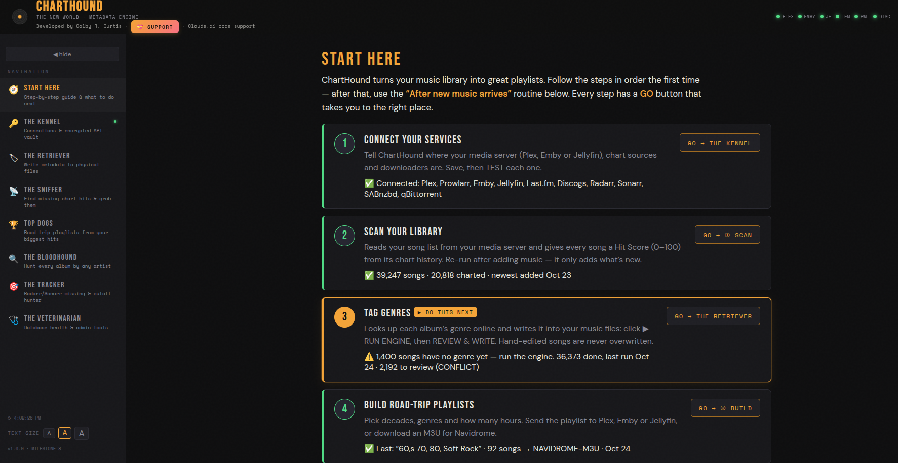
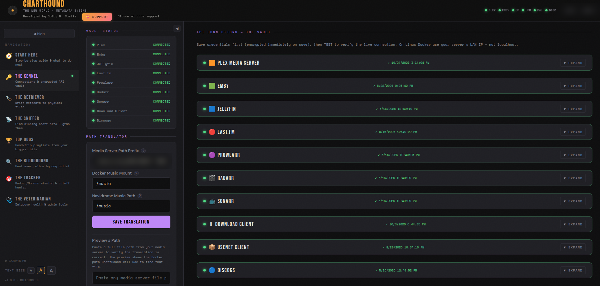
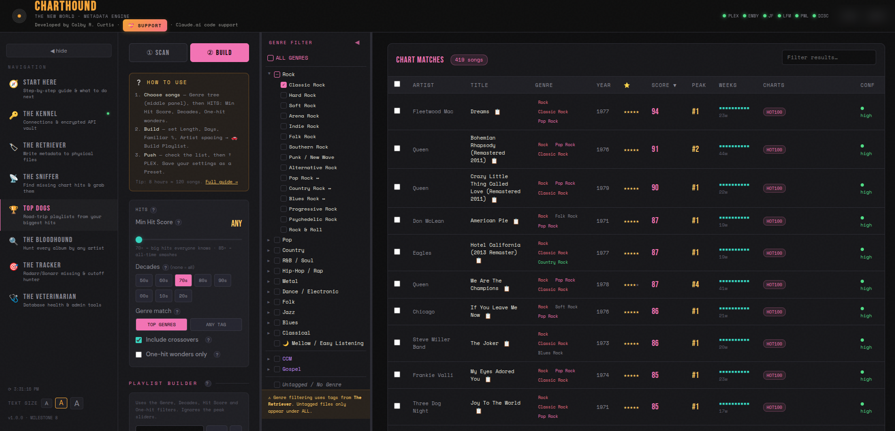
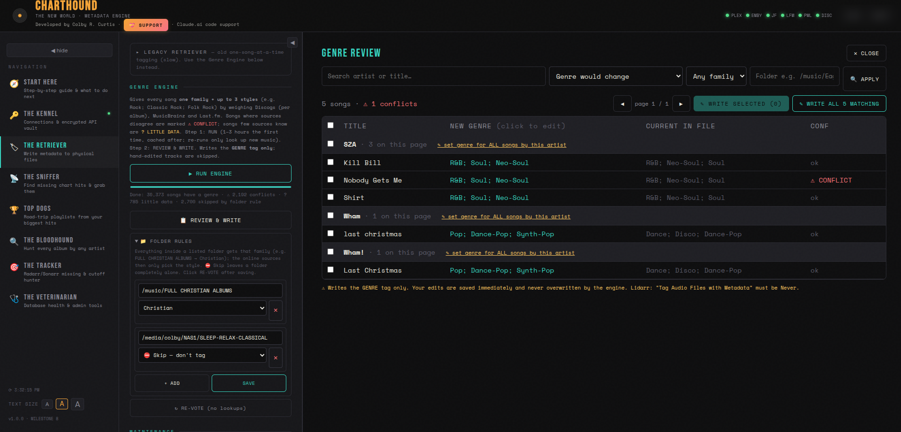
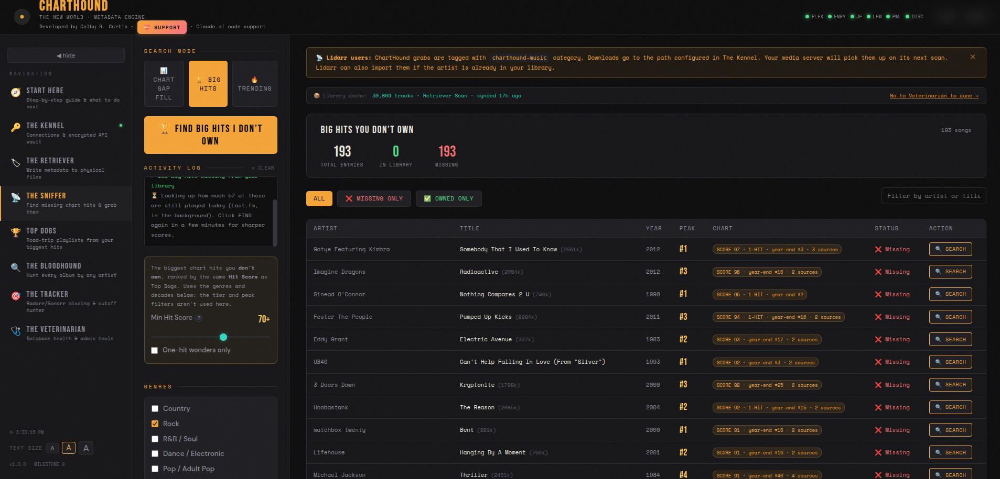
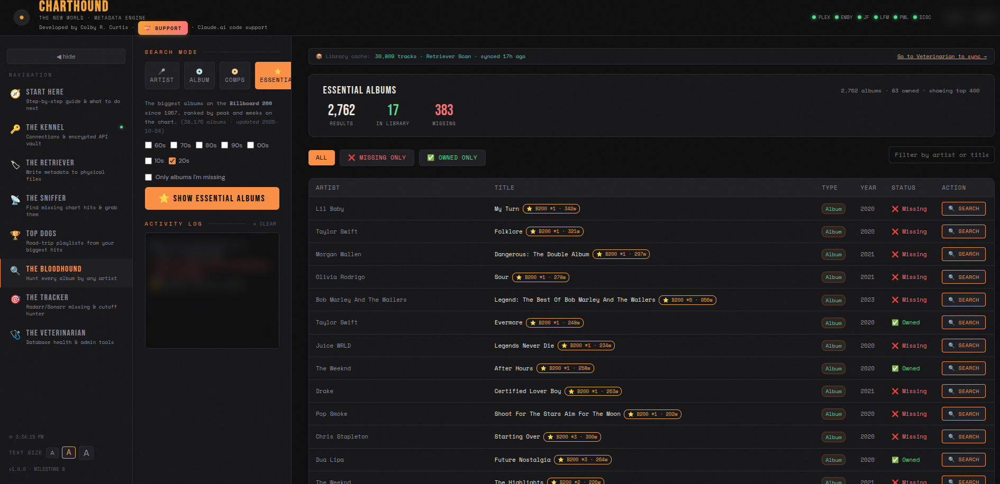
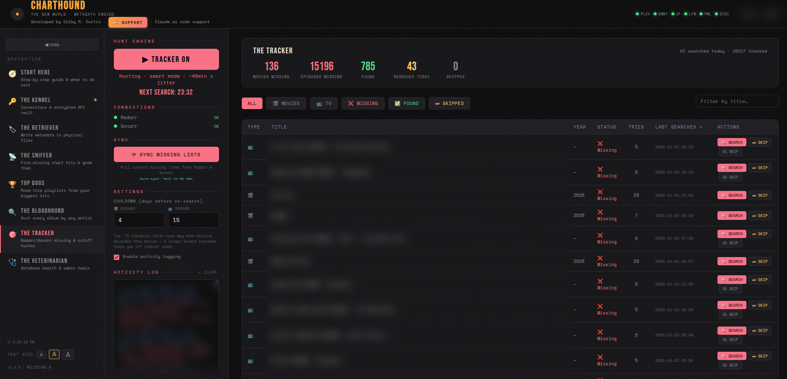
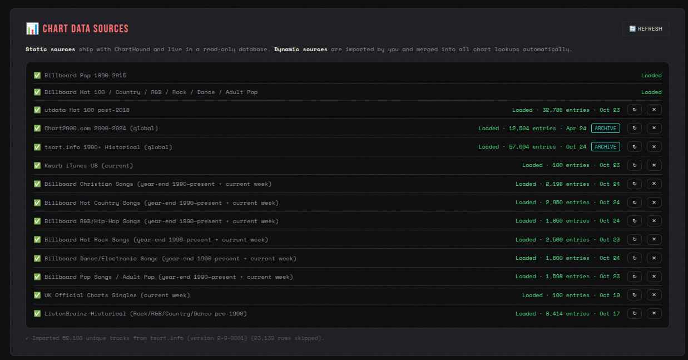

# 🐕 ChartHound — The New World

**A self-hosted music *and media* library management engine built for power users.**

Score every song in your library by its real chart history, tag genres into your files, build road-trip playlists from your biggest hits, discover the hits and essential albums you're missing — *and* automatically find missing movies and TV episodes from your Radarr/Sonarr libraries. All from a single Dockerized dashboard that never exposes your API keys.

**New here?** ChartHound opens on a **🧭 Start Here** page that walks you through every step in order and tells you what to do next.

**Developed by Colby R. Curtis** · [Buy Me a Coffee](https://buymeacoffee.com/colbycurtis)

> Built with Python (FastAPI), SQLite, and vanilla JavaScript.
> Code support by Claude.ai (Anthropic).

---

## A Note From the Developer

ChartHound started life as a janky little HTML file on my laptop.

I was tired of my Plex music library being a graveyard of mistagged albums and missing chart hits, so I wrote a 200-line Python script to make custom playlists for my server. Then I needed a way to know which songs in my library were actually #1 hits, so I bolted on a chart database. Then I needed it to push playlists to Plex. Then to Emby. Then to Jellyfin.

At some point I looked up and realized "just a playlist creator" wasn't going to cut it anymore. So I spent many evenings and weekends developing a full-featured music and media management tool — adding album hunting through MusicBrainz, missing-media tracking through Radarr and Sonarr, chart hit discovery, file-first metadata tagging, and a properly secured connection vault for all the API keys it now needed. My OCD had absolutely taken the wheel, and the "little tool just for me" had grown teeth.

I'm a solo developer. ChartHound exists because I wanted it to exist. I write the code with Claude (Anthropic's AI) as my code support partner — Claude helps me think through architecture, catches my bugs in code review, and writes the boilerplate I'd otherwise have to type by hand. Every architectural decision, every feature, and every line of business logic is mine. I actively review every change, question every approach, and push back when something isn't right. The result is code I actually understand, written faster than I could write alone.

Months of work later, I did a full security audit and hardening pass on April 24, 2026 — auditing the auth flow, encrypting credentials, locking down the registration endpoint, reviewing every endpoint for token exposure — before deciding to share ChartHound with the community. Additional security patches and hardening have been applied since. If you're a Plex, Emby, or Jellyfin user who cares about your music library the way I care about mine, I think you'll find a lot to like here.

If ChartHound saves you time, [a coffee](https://buymeacoffee.com/colbycurtis) is appreciated but never expected. The tool is yours — go make your music library beautiful.

— **Colby**

---

## Table of Contents

- [Why ChartHound?](#why-charthound)
- [What's New](#whats-new)
- [Security Model](#security-model)
- [Requirements](#requirements)
- [Quick Start](#quick-start)
- [Docker Compose Reference](#docker-compose-reference)
- [First Boot](#first-boot)
- [Getting API Keys](#getting-api-keys)
- [The Tabs](#the-tabs)
- [The Little Things](#the-little-things)
- [Reverse Proxy Setup](#reverse-proxy-setup)
- [Updating ChartHound](#updating-charthound)
- [Troubleshooting](#troubleshooting)
- [Support ChartHound](#support-charthound)
- [Disclaimer](#disclaimer)
- [License](#license)

---

## Why ChartHound?

Most music tools focus on one thing — tagging, or searching, or playlist building. Most media tools focus only on movies and TV. ChartHound combines all of them into a single self-hosted application that understands your entire media ecosystem — music, movies, and TV all in one place.

ChartHound knows which songs in your library were Billboard #1 hits, which albums you're missing from an artist's discography, and which movies and TV episodes in your Radarr/Sonarr watchlists still haven't been found. It writes real chart performance data directly into your music file metadata so your media server can display it. It hunts down missing media in the background while you sleep. And it does all of this without ever sending your API keys or tokens outside your local network.

---

## What's New

The October 2026 update is the biggest release since ChartHound went public:

- **🧭 Start Here** — a guided first page with six numbered steps, live ✅/⚠️ status from your own data, **GO** buttons, and an "After new music arrives" routine. Plus an **A / A / A text-size control** in the sidebar.
- **Top Dogs** (formerly The Groomer) — every song gets a **Hit Score (0–100)** from its Hot 100 peak, weeks, year-end rank and genre-chart breadth, boosted by Last.fm staying power. Build playlists by decade, genre and *hours of music*, with one-hit wonders, crossovers, presets and multi-day sets.
- **Genre Engine** (The Retriever) — one genre family plus up to three styles per song, decided by a weighted vote of Discogs, MusicBrainz and Last.fm, reviewed by you before anything is written.
- **🏆 Big Hits** (The Sniffer) and **⭐ Essential Albums** (The Bloodhound) — the biggest songs and Billboard 200 albums you don't own yet.
- **Smarter Tracker** — newest releases first, back-off for titles that keep missing, auto-skip for long-lost old titles, and real "did it grab anything?" checks.
- **Fixes** — Billboard renamed several genre charts in 2026 (Christian, Country, R&B/Hip-Hop, Dance) and ChartHound now follows the new names; torrents grabbed with qBittorrent 5.x no longer land as 0-byte "seeding".

---

## Security Model

ChartHound was designed from the ground up with security as a hard requirement — not an afterthought. A full security audit and hardening pass was completed on April 24, 2026, before the project was shared publicly. Additional security patches have been applied since initial release.

### Encrypted Vault (The Kennel)

Every API key, token, and password you enter into ChartHound is encrypted using **Fernet symmetric encryption** (AES-128-CBC with HMAC-SHA256) before being stored in the SQLite database. The encryption key is your `SECRET_KEY` environment variable, which never leaves your Docker container. There is no "show password" button. There is no API endpoint that returns decrypted credentials. Keys are decrypted in-memory only at the moment they are needed to make an API call, and only on the backend — the browser never sees them.

### Zero Key Transmission

When ChartHound connects to your Plex, Radarr, Sonarr, Prowlarr, or any other service, those API calls happen **server-side inside the Docker container**. Your browser sends a request to ChartHound's backend ("search for this artist"), and the backend handles the actual API call using the decrypted credentials. Your API keys are never included in any HTTP response sent to the browser. They never appear in network traffic between your browser and ChartHound.

### Auto-Lockdown Registration

On first boot, ChartHound allows one user registration to create the admin account. After that, the registration endpoint is automatically disabled and the "Sign Up" link is hidden from the UI. No configuration needed — it locks itself. If you need to add another user later, you temporarily set `CH_OPEN_REGISTRATION=true` in your compose file, add the user, and set it back to `false`.

### Session Authentication

Every API endpoint (except login/register and the health check) requires a valid JWT session token. Unauthenticated requests are rejected with a 401. There are no backdoor endpoints, no debug routes that bypass auth, no settings pages accessible without a session. Sessions last 7 days and gracefully redirect to the login screen with a clear banner when expired.

### Reverse Proxy Requirement

ChartHound should always be accessed through a reverse proxy with a valid SSL/TLS certificate when exposed beyond your local network. The application itself runs on HTTP inside the container (port 8000). Your reverse proxy (Caddy, Nginx, Traefik) handles HTTPS termination. This ensures all traffic between your browser and ChartHound is encrypted in transit. See the [Reverse Proxy Setup](#reverse-proxy-setup) section below.

---

## Requirements

ChartHound connects to your existing media stack. You don't need all of these — only the ones relevant to the features you want to use.

**Required:**
- Docker and Docker Compose
- A music library on a local or network drive

**For scoring, genres and playlists (Top Dogs & Retriever):**
- Plex, Emby, or Jellyfin (to read your library). Navidrome users can download M3U playlists.
- **Last.fm API key** — *strongly recommended.* Adds the "staying power" boost to Hit Scores, finds never-charted classics everyone still plays, and is one of the three Genre Engine sources. Free, takes 30 seconds.
- **Discogs personal access token** — *strongly recommended* for the Genre Engine (it carries the most weight in the genre vote).

**For music discovery (Sniffer & Bloodhound):**
- Prowlarr (indexer manager)
- A download client — **one** of the following:
  - qBittorrent, Deluge, or Transmission (for torrents)
  - SABnzbd (for Usenet/NZB downloads)
- You can connect both a torrent client and SABnzbd simultaneously — ChartHound supports grabbing via either protocol depending on the indexer result.

**For movie/TV hunting (Tracker):**
- Radarr (movie management)
- Sonarr (TV management)
- Prowlarr connected to Radarr/Sonarr (ChartHound tells Radarr/Sonarr to search — they handle Prowlarr internally)


---

## Quick Start

### 1. Clone the Repository

```bash
git clone https://github.com/CurtisColby/ChartHound.git
cd ChartHound
```

### 2. Generate Your Secret Key

Pick one command for your platform:

```bash
# Linux / Mac / Unraid / TrueNAS
python3 -c "import secrets; print(secrets.token_hex(32))"

# Windows PowerShell
python -c "import secrets; print(secrets.token_hex(32))"

# If Python is not installed
docker run --rm python:3.12-slim python3 -c "import secrets; print(secrets.token_hex(32))"
```

Copy the output. You'll paste it into your compose file in the next step.

### 3. Configure Docker Compose

```bash
cp docker-compose_example.yml docker-compose.yml
```

Open `docker-compose.yml` in a text editor and replace every `CHANGE_ME` value. The file is heavily commented — read each section carefully. The critical values are:

- **`SECRET_KEY`** — paste the key you generated above
- **Music library path** — the folder where your music lives
- **`MEDIA_SERVER_MUSIC_PREFIX`** — the path your media server uses for your music (check any track's file info in Plex/Emby/Jellyfin)

### 4. Build and Start

```bash
docker compose up --build -d
```

### 5. Open ChartHound

Navigate to `http://YOUR-SERVER-IP:8585` in your browser and create your admin account. ChartHound opens on **🧭 Start Here** — follow the numbered steps, using each **GO** button. A full **User Guide** is also built in (**OPEN USER GUIDE** in The Kennel's left panel).

---

## Docker Compose Reference

| Environment Variable | Required | Description |
|---|---|---|
| `SECRET_KEY` | Yes | Fernet encryption key for all stored credentials. Generate with `secrets.token_hex(32)`. Treat like a master password. |
| `DATABASE_URL` | No | Path to dynamic database inside container. Default: `/data/charthound.db` |
| `STATIC_DB_URL` | No | Path to static chart database. Default: `/data/charthound_static.db` |
| `CH_OPEN_REGISTRATION` | No | Set to `true` to allow new user registration. Default: `false` (auto-lockdown after first user). |
| `MEDIA_SERVER_MUSIC_PREFIX` | Yes | The file path prefix your media server uses for music. Used for path translation. |
| `DOCKER_MUSIC_PREFIX` | No | The mount point inside Docker. Default: `/music`. Do not change unless you modified the volume mapping. |

| Volume Mount | Purpose |
|---|---|
| `YOUR_MUSIC_PATH:/music` | Your music library. ChartHound writes metadata tags to files here. Never moves, renames, or deletes files. |
| `YOUR_MUSIC_PATH:YOUR_MUSIC_PATH` | Second mount at the same path. Required for FLAC tag writing on NAS/network drives due to Docker filesystem behavior. |
| `YOUR_STATIC_DB_PATH:/data/charthound_static.db:ro` | Pre-populated Billboard chart database. Read-only. Ships with the repository. |
| `charthound_data:/data` | Named volume for the dynamic database. Persists across container rebuilds. |

---

## First Boot

When you first open ChartHound, you'll see a login screen. Since no users exist yet, click **"Create Account"** to register your admin account. After registration, the signup option is permanently hidden (auto-lockdown — see [Security Model](#security-model) for details).

Once logged in you land on **Start Here**. Step 1 sends you to **The Kennel** to connect your services. Each service card has fields for the server URL and API key/token. When you click Save, the credentials are encrypted and stored. When you click Test, ChartHound verifies the connection actually works. The [Getting API Keys](#getting-api-keys) section below walks you through how to obtain each one.

> 📖 **A full User Guide is built into ChartHound.** Once logged in, find the **OPEN USER GUIDE** button in The Kennel's left panel under "HELP & DOCS". It covers every tab — what it does, what needs to be connected, and best practices — including step-by-step first-time setup instructions.

---

## Getting API Keys

Most of ChartHound's features rely on free third-party APIs. None of them require credit cards. Here's how to get the ones that matter most.

### Last.fm API Key (strongly recommended)

ChartHound ships with over 108,000 real Billboard chart entries pre-loaded, and imports more from the Veterinarian. Last.fm adds what charts can't: how much people **still** listen to a song today. ChartHound uses it for the Hit Score "staying power" boost, to find **never-charted classics** (songs with 300,000+ listeners that never made a chart), for the Sniffer's Big Hits, and as one of the three Genre Engine sources. Everything works without it — just with less insight. Lookups are cached for 180 days, so a whole library only costs one pass.

It's free and takes 30 seconds.

**Step 1 — Create a Last.fm API account**

Go to [last.fm/api/account/create](https://www.last.fm/api/account/create). Fill in the application name (e.g., `ChartHound`), description, and contact email. Application Homepage and Callback URL can be left blank or filled with anything — ChartHound doesn't use OAuth.

**Step 2 — Copy the API Key**

Last.fm gives you both an API Key and a Shared Secret. ChartHound only needs the **API Key** (the longer string). Copy it.

**Step 3 — Paste it into The Kennel**

In ChartHound, open **The Kennel**, find the Last.fm card, paste the key, **Save**, then **Test**.

### Discogs Personal Access Token (recommended for genre data)

Discogs provides the best genre and style data available for free — it carries the most weight in the Genre Engine's vote. ChartHound looks up each **album** once (not every track), so even a 40,000-song library is a manageable first run.

**Step 1 — Create a Discogs account**

Sign up at [discogs.com](https://www.discogs.com/) if you don't already have one. (Discogs is also a fantastic site for collectors — worth using even outside ChartHound.)

**Step 2 — Generate a personal access token**

Go to [discogs.com/settings/developers](https://www.discogs.com/settings/developers) and click **Generate new token**. Copy the token immediately — Discogs only shows it once.

**Step 3 — Paste it into The Kennel**

In ChartHound, open **The Kennel**, find the Discogs card, paste the token, **Save**, then **Test**.

> Discogs rate-limits at 60 requests per minute. ChartHound respects this automatically.

### Plex / Emby / Jellyfin Tokens

Each media server hands out tokens differently:

- **Plex:** Sign in at [plex.tv](https://www.plex.tv/), then visit any item in your web app. View the page source and search for `X-Plex-Token` — your token is the value. Or follow [this official Plex guide](https://support.plex.tv/articles/204059436-finding-an-authentication-token-x-plex-token/).
- **Emby:** Dashboard → Advanced → API Keys → **+ New API Key**. Name it `ChartHound`.
- **Jellyfin:** Dashboard → Advanced → API Keys → **+ Add Key**. Name it `ChartHound`.

For all three, paste the token (and the server URL — usually something like `http://192.168.1.x:32400` for Plex or `http://192.168.1.x:8096` for Emby/Jellyfin) into the corresponding card in The Kennel and test.

> **Jellyfin gotcha:** if the test fails despite a correct token, add Docker's bridge subnet (`172.28.0.0/16`) to Jellyfin's LAN Networks list (Dashboard → Networking → LAN Networks). Jellyfin blocks unrecognized internal IPs by default.

### Radarr / Sonarr / Prowlarr

For all three, the API key is in **Settings → General → API Key**. Copy it from the Arr app's UI and paste it into the matching ChartHound Kennel card along with the server URL.

### Download Clients

ChartHound supports four download clients. You only need the ones relevant to your setup — a torrent client, a Usenet client, or both.

**qBittorrent** — uses username/password authentication, not an API key. Open the qBittorrent Web UI settings and confirm Web UI is enabled, then put the URL (`http://your-server:8080`), username (default `admin`), and password into ChartHound's qBittorrent card. ChartHound logs in once per session and uses the cookie. Works with qBittorrent 4.x and 5.x, including the "bypass authentication for whitelisted IPs" setup common behind Gluetun. After each grab, ChartHound makes sure every file in the torrent is ticked and started — waiting up to 15 minutes for slow magnet links to fetch their file list.

> **Important:** the **ChartHound Download Path** in The Kennel must be a folder your *download client* can see (its own container path), and that folder should be inside a library your media server scans.

**Deluge** — uses the Deluge WebUI password. Make sure the WebUI plugin is enabled in Deluge preferences. Enter the WebUI URL (`http://your-server:8112`) and the WebUI password into ChartHound's Deluge card. ChartHound authenticates via Deluge's JSON-RPC interface.

**Transmission** — uses username/password authentication. Make sure Transmission's web interface is enabled with a username and password configured. Enter the URL (`http://your-server:9091`), username, and password into ChartHound's Transmission card. ChartHound handles the session ID handshake automatically.

**SABnzbd** — uses an API key. In SABnzbd, go to **Config → General** and copy the API Key. Enter the SABnzbd URL (`http://your-server:8080`) and API key into ChartHound's SABnzbd card. ChartHound sends NZB downloads to SABnzbd with a `charthound-music` category tag.

> **Tip:** You can have one torrent client *and* SABnzbd connected at the same time. When grabbing a release, ChartHound automatically routes torrents to your torrent client and NZBs to SABnzbd based on the indexer type.

### A note on Spotify

ChartHound has no Spotify integration — and that's deliberate. Spotify changed their developer terms to require a **Premium account** to use their API, which defeats the entire purpose of running your own self-hosted music library. ChartHound gets the popularity, charting, and metadata signals it needs from MusicBrainz, Last.fm, ListenBrainz, Deezer, Discogs, iTunes, and the static Billboard chart database — all free, all working without strings attached.

---

## The Tabs

### 🧭 Start Here — Your Guided Path
*Step-by-step guide & what to do next*



The first page you see. Six numbered steps — **Connect → Scan → Tag Genres → Build Playlists → Fill the Gaps → Movies & TV** — each with a plain-English explanation, a live status from your own data (✅ done, ⚠️ needs attention), and **GO** buttons that take you straight to the right tab and view. The first unfinished step is highlighted **▶ DO THIS NEXT**.

Below the steps is the **🔁 After new music arrives** routine — the four things to do whenever downloads finish, so new songs get Hit Scores and genres. If you haven't opened ChartHound in months, start here.

The sidebar's **TEXT SIZE A / A / A** control makes the whole app larger or smaller and remembers your choice.

### The Kennel — Connection Vault
🔑 *Connections & Encrypted API Vault*



Connect ChartHound to your media stack. Each service has a card: enter the URL and key, **SAVE** (encrypted immediately with your SECRET_KEY), then **TEST** (decrypted server-side, one live API call). Verified cards collapse to a single green line.

**Supported services:** Plex, Emby, Jellyfin, Last.fm, Discogs, Prowlarr, Radarr, Sonarr, qBittorrent, Deluge, Transmission, SABnzbd

**Path Translator:** converts between your media server's file paths and Docker's `/music` mount, and sets the Navidrome music path for M3U playlists. **ChartHound Download Path** (Download Client card) sets where Sniffer/Bloodhound grabs are saved — as your download client sees it.

### Top Dogs — Hit Scores & Road-Trip Playlists
🏆 *Road-trip playlists from your biggest hits* (formerly **The Groomer**)



Two views: **① SCAN** and **② BUILD**.

**① SCAN** reads your library from Plex, Emby or Jellyfin and matches every song against the chart database. Re-scans are incremental — only new songs are looked up. Each song gets a **Hit Score from 0 to 100** built from its Hot 100 peak, weeks on the chart, year-end rank and how many genre charts it reached, plus a Last.fm "staying power" boost. A 100 is rare; 70+ is "everyone knows it", 85+ is an all-time smash. Songs that never charted but have 300,000+ Last.fm listeners are included as **never-charted classics**. Optionally writes the chart history into each file's COMMENT tag with a star rating.

**② BUILD** turns scores into playlists:
- **Genre tree** — pick families and styles (from the Genre Engine), with **crossovers** and a 🌙 **Mellow / Easy Listening** vibe
- **Hits filters** — minimum Hit Score, decades, one-hit wonders only
- **Playlist builder** — set the length in *hours*, split into multiple days, choose how familiar it should be and how far apart the same artist can repeat
- **Presets** — save a set of choices and reload it later
- **Push** — sends the playlist to Plex, Emby or Jellyfin *in order* (strict artist+title matching, never a wrong song), or download an **M3U / Navidrome M3U**

Duplicate copies of the same song across albums and libraries are collapsed so a playlist never repeats a track.

### The Retriever — Genre Engine
🏷 *Write genres to your physical files*



The **Genre Engine** gives every song **one family plus up to three styles** — e.g. `Rock; Classic Rock; Folk Rock` — by a weighted vote:

| Source | Weight |
|---|---|
| Discogs album styles | 3 |
| Discogs album genres, MusicBrainz, Last.fm track tags | 2 |
| Last.fm artist tags | 1 |

Lookups are batched **one per album** and cached, so the first run takes 1–3 hours for a large library and later runs only look up new music. Songs where sources disagree are marked **⚠ CONFLICT**; songs few sources know are **? LITTLE DATA**. Broad families win over obscure community tags, and subjective tags ("awesome", "favorites") are ignored.

1. **▶ RUN ENGINE** — look everything up and vote. **RE-VOTE** re-decides from the cache in seconds, no lookups.
2. **REVIEW & WRITE** — page through every change, filter by family, folder or conflicts, edit any song or a whole artist, then write selected or all. Your edits are saved as **manual** and never overwritten.

**Folder rules** let a folder decide the family (e.g. `FULL CHRISTIAN ALBUMS → Christian`) or be skipped entirely. Only the **GENRE tag** is written — and always to the file first. The original one-song-at-a-time **Legacy Retriever** is still available, collapsed at the top.

> **Lidarr users:** set Lidarr → Settings → Metadata → "Tag Audio Files with Metadata" to **Never**, or Lidarr will overwrite ChartHound's genres.

### The Sniffer — Chart Hit Finder
📡 *Find Missing Chart Hits & Grab Them*



Cross-references your library against the chart database and shows what you're missing. Three modes:

- **🏆 Big Hits** — the highest Hit Score songs you don't own, ranked the same way as Top Dogs, filtered by genre, decade and minimum score. Last.fm listener counts fill in quietly in the background.
- **Chart Gap Fill** — every charting song you don't own by genre, decade and tier (Essential / Notable / Deep Cuts).
- **Trending** — top tracks by genre from Last.fm.

For any missing song, **SEARCH** queries Prowlarr (album-first, like Lidarr) and shows seeders and size. One click sends a torrent to qBittorrent/Deluge/Transmission or an NZB to SABnzbd, tagged `charthound-music`. After a Top Dogs build, a shortcut shows how many big hits in that playlist's style you don't own yet.

### The Bloodhound — Album Hunter
🔍 *Hunt Every Album by Any Artist*



Five search modes:

- **⭐ Essential** — the biggest albums on the **Billboard 200** since 1967 (38,000+ albums, refreshed weekly), ranked by peak and weeks on chart, filterable by decade and "only albums I'm missing".
- **Artist** — an artist's complete discography from MusicBrainz, filtered by release type. Albums that hit the Billboard 200 get a **B200** badge, and the essential ones are marked ⭐.
- **Album** — search any album by name.
- **Compilations** — 31 preset series (Now That's What I Call Music, WOW Hits, Grammy Nominees…) plus custom search.
- **Genre Browse** — by primary genre, sub-genres included automatically.

Every result shows **Owned** or **Missing**, and missing releases can be searched on Prowlarr and grabbed directly.

### The Tracker — Missing Movies & TV
🎯 *Radarr / Sonarr missing & cutoff hunter*



Watches Radarr and Sonarr for missing movies and episodes and asks them to search — slowly and politely, in the background, even with the browser closed. ChartHound never talks to your indexers directly; Radarr and Sonarr handle that as they normally do.

- **Off by default** — turn it on from the Tracker page
- **Newest first** — anything released in the last 90 days, then the last 2 years, then older titles (fewest tries first)
- **Back-off** — each miss doubles the wait before the next try (per-source base cooldown, capped at 30 days); old titles that keep missing drop to monthly
- **Auto-skip** — titles older than 2 years that miss 12 times are marked *Skipped (auto)*; **UNSKIP** gives them a fresh start. New releases are never auto-skipped.
- **Grab check** — 15 minutes after each search, ChartHound asks Radarr/Sonarr's history whether anything was actually grabbed and logs **GRABBED** or a miss
- **TV-weighted** — three TV searches for every movie search, matching the typical backlog
- **Season-aware** — season searches instead of single episodes; an earlier missing season waits, except the newest season and fresh releases. Skip a stuck season to unblock later ones.
- **Gentle timing** — about one search every 40 minutes with ±25% random jitter; auto-sync every 6 hours (if one series fails to sync, its history is kept rather than reset)
- **Manual control** — search now, skip, unskip, and a full activity log

### The Veterinarian — Database & Chart Sources
🩺 *Database Health & Admin Tools*



**Chart Data Sources** lists every chart ChartHound knows: the read-only static database that ships with it, plus dynamic sources you can import and refresh — utdata Hot 100 (post-2018), Billboard genre charts (Christian, Country, R&B/Hip-Hop, Rock, Dance/Electronic, Pop — year-end since 1990 plus the current week), Chart2000 and tsort.info global charts, Kworb iTunes, UK Official Singles and ListenBrainz historical. Each shows its entry count and last refresh, with ↻ to refresh and ✕ to remove; a red **REFRESH FAILING** badge means the website changed and the existing data is being kept. Historical sources that no longer change are marked **ARCHIVE**. (The Billboard 200 album data behind Essential albums refreshes itself weekly.)

Also here: track/album/artist counts, skip-cache stats, library cache sync, **VACUUM** and **INTEGRITY CHECK**, and an in-tab debug console (off by default, 1,000-line cap).

The **Clear Full Database** button lives in the danger zone for a reason — ChartHound's database accumulates months of lookups (see [The Little Things](#the-little-things)). For routine maintenance use VACUUM and integrity check instead. To refresh only the Retriever's lookups, use **CLEAR METADATA CACHE** on The Retriever — your tracks, Hit Scores and hand edits are kept.

---

## The Little Things

Software like this lives or dies on the details. ChartHound has spent a lot of time on the things you'd never notice — until they save you from a problem you didn't know you had.

### Song-level deduplication

The same song often lives in your library three times — the original album, a greatest-hits set, and a compilation. Top Dogs collapses them to one song (normalized artist + title) so a playlist never repeats a track, and the Sniffer counts you as owning a song no matter which album it's on.

### The Tracker's request jitter

When the Tracker fires search commands at Radarr or Sonarr, it doesn't blast them out at predictable intervals. Searches are about 40 minutes apart with ±25% random jitter, so the request pattern looks more like a human clicking buttons than a bot pounding an API. This keeps your indexers happier and reduces the chance of getting rate-limited mid-batch.

### Top Dogs' skip cache

Re-scanning a 40,000-track library is expensive. Top Dogs remembers which tracks have already been processed and skips them on subsequent runs unless something changed. The first scan takes a while; every scan after that is fast. The cache is automatically invalidated when a track's path or metadata changes.

### Your library gets faster the longer you use it

ChartHound's database isn't just storage — it's a knowledge cache. Every scan teaches it something. Track fingerprints, chart matches, MusicBrainz IDs, Discogs lookups, Last.fm popularity scores, album-folder hashes, the skip cache, the path index, the genre-resolution waterfall results — all of it accumulates and gets reused on subsequent runs. The first scan of a 33,000-track library is the slowest one you'll ever do. Every scan after that gets faster as the database fills out and fewer tracks need fresh lookups.

This is why the Veterinarian's "Clear Full Database" button is in the danger zone — and why you should treat it that way. Clearing the database wipes all that accumulated knowledge and sends you back to first-scan speeds. Only use it if the database has actually become corrupted, or if you want to genuinely start over. Day-to-day, a database that's been growing for weeks is a feature, not clutter.

### File-first metadata writes

Every metadata update goes to the *physical file* via Mutagen *before* ChartHound asks Plex/Emby/Jellyfin to refresh. This means your tags survive a media server migration. If you switch from Plex to Jellyfin tomorrow, your chart data goes with you because it lives in the files, not in some database you can't export.

### Bounded debug consoles

The Veterinarian's debug console (and other in-tab consoles) are capped at 1,000 lines and turned off by default. Debug output can pile up fast — a long-running scan can generate thousands of log lines per minute. The cap and opt-in behavior keep the UI snappy and the noise out of your way unless you explicitly ask for it.

### Album batching

The Genre Engine groups tracks by album and makes one Discogs lookup per album instead of one per track. For a 40,000-track library, that's the difference between ~40,000 API calls and ~3,000. Same data, an order of magnitude less work. MusicBrainz is held to one request per second, as its rules ask.

### Torrents that actually start

Some torrents arrive in qBittorrent with every file unticked, which makes qBittorrent mark them "complete" and seeding with 0 bytes. ChartHound tracks the exact torrent it added, ticks every file, and starts it — waiting up to 15 minutes for slow magnets to find their file list.

### Aggressive caching everywhere

Static chart data ships in a read-only SQLite database with the project. Lookups against your library check local SQLite first, external APIs second. The whole architecture is designed around the assumption that your time and your API quotas matter.

### Auto-lockdown registration

The first user to register becomes the admin. The moment that user exists, the registration endpoint auto-disables and the "Sign Up" link is hidden from the UI. There's no checkbox to forget, no manual step to remember. ChartHound locks itself.

### Encrypted credentials, never visible

Every API key, token, and password is Fernet-encrypted before it touches the database. There is no "show password" button. There is no API endpoint that returns decrypted credentials. Keys are decrypted in memory only at the moment they're used, on the backend, never sent to the browser. If someone steals your `charthound.db` file, they get nothing usable without your `SECRET_KEY`.

### iTunes rate-limit respect

When ChartHound talks to iTunes for metadata, it strictly enforces a 20-requests-per-minute fixed window — Apple's documented limit. We never burst-fire requests, even during big batch operations. It takes longer; it doesn't get our IPs throttled.

---

## Reverse Proxy Setup

ChartHound should be placed behind a reverse proxy with SSL/TLS when accessed outside your local network. Here are examples for common reverse proxies.

### Caddy (Recommended — automatic HTTPS)

```
charthound.yourdomain.com {
    reverse_proxy localhost:8585
}
```

That's it. Caddy automatically provisions and renews a Let's Encrypt certificate.

### Nginx

```nginx
server {
    listen 443 ssl;
    server_name charthound.yourdomain.com;

    ssl_certificate     /etc/letsencrypt/live/charthound.yourdomain.com/fullchain.pem;
    ssl_certificate_key /etc/letsencrypt/live/charthound.yourdomain.com/privkey.pem;

    location / {
        proxy_pass http://localhost:8585;
        proxy_set_header Host $host;
        proxy_set_header X-Real-IP $remote_addr;
        proxy_set_header X-Forwarded-For $proxy_add_x_forwarded_for;
        proxy_set_header X-Forwarded-Proto $scheme;
    }
}
```

### Traefik (Docker labels)

```yaml
labels:
  - "traefik.enable=true"
  - "traefik.http.routers.charthound.rule=Host(`charthound.yourdomain.com`)"
  - "traefik.http.routers.charthound.tls.certresolver=letsencrypt"
  - "traefik.http.services.charthound.loadbalancer.server.port=8000"
```

---

## Updating ChartHound

```bash
cd ~/ChartHound
git pull
docker compose up --build -d
```

Your dynamic database (`charthound.db`) is stored in a Docker named volume and survives rebuilds. Your connections, scan history, and user account are preserved. After updating, hard-refresh your browser (**Ctrl+Shift+R**) so it loads the new interface files.

---

## Troubleshooting

**Container won't start after an update:**
```bash
docker stop charthound
docker compose up --build -d
```

**Forgot your password:**
```bash
docker exec charthound python3 -c "
import bcrypt, asyncio, aiosqlite
async def reset():
    hashed = bcrypt.hashpw(b'NewPassword1!', bcrypt.gensalt()).decode()
    async with aiosqlite.connect('/data/charthound.db') as db:
        await db.execute('UPDATE users SET password_hash=? WHERE username=?', (hashed, 'YourUsername'))
        await db.commit()
asyncio.run(reset())"
```

**Jellyfin connection fails:**
Add Docker's subnet to Jellyfin's LAN Networks list: `172.28.0.0/16` (Jellyfin Dashboard → Networking → LAN Networks).

**SECRET_KEY warning on startup:**
You haven't replaced the placeholder key in your `docker-compose.yml`. Generate one with `python3 -c "import secrets; print(secrets.token_hex(32))"` and restart the container.

**Download client on a different machine:**
ChartHound and your download client don't need to be on the same server. Enter the download client machine's LAN IP and port in The Kennel (e.g., `http://192.168.1.100:8080` for qBittorrent, `http://192.168.1.100:8112` for Deluge, `http://192.168.1.100:9091` for Transmission, `http://192.168.1.100:8080` for SABnzbd).

**A torrent shows 0 B and "Seeding" right after a grab:**
Its files were added unticked. Current versions fix this automatically; on an older version, open the torrent's **Content** tab in qBittorrent, tick all files, and **Force Resume**.

**A grab never shows up in your library:**
Check that **ChartHound Download Path** in The Kennel is a path your download client can see *inside its own container*, and that the folder is inside a library your media server scans.

**A chart source shows "REFRESH FAILING":**
The website changed. Your existing chart data is kept and still used; update ChartHound to pick up fixes.

**Genres from ChartHound keep disappearing:**
Lidarr is rewriting your tags. Set Lidarr → Settings → Metadata → "Tag Audio Files with Metadata" to **Never**.

**Session expired banner appears unexpectedly:**
ChartHound sessions last 7 days. After that you'll see a clear "session expired" banner on the login screen — log back in and you're good. Your data, settings, and connections are all preserved.

---

## Support ChartHound

ChartHound is free for personal use today, and that isn't changing anytime soon. The current license is non-commercial — it's the tool I built for myself, shared with anyone who can use it. If it saves you time or makes your library better, here are some ways to chip in.

### Buy Me a Coffee

The easiest way. One-time tips of any amount.

[☕ buymeacoffee.com/colbycurtis](https://buymeacoffee.com/colbycurtis)

### Monthly sponsorship *(coming soon)*

GitHub Sponsors enrollment is in progress. Once active, it'll let you set up recurring contributions starting around $2/month with a custom-amount option. Watch this space — link will go live as soon as enrollment completes.

### Cryptocurrency

For users who prefer crypto, donations are welcome:

- **Bitcoin (BTC · Native SegWit):**  
  `bc1qdr9j5al9qq29cskrjxvm4myzq4se4c3kk6p8hv`
- **Ethereum (ETH · ERC-20 OK):**  
  `0x60D4519eA1CcBAB149403e232C54468572f783C7`

These addresses match the ones in ChartHound's in-app donation panel, so you can verify them by checking your own UI.

### Other ways to help (free)

If money isn't on the table, there's plenty else that helps:

- **⭐ Star the repo on GitHub** — visibility helps more than people think
- **🐛 Report bugs** — open an issue with reproduction steps and I'll get to it
- **💡 Share use cases** — tell me how you're using ChartHound, what's working, what's not. Real user feedback shapes the roadmap.
- **📣 Spread the word** — tell other Plex/Emby/Jellyfin users. r/selfhosted, r/Plex, the Awesome-Selfhosted list, your homelab Discord.

---

## Disclaimer

ChartHound is a library management tool. Any downloading functionality is intended for use with content you have legally purchased or are otherwise authorized to obtain. The developer is not responsible for how users choose to use this software. Always comply with the copyright laws in your jurisdiction.

---

## License

**Copyright © 2026 Colby R. Curtis. All Rights Reserved.**

This software is licensed for **personal, non-commercial use only**. You may view the source code and run the software for personal use. Modification, redistribution, forking (beyond local personal use), and commercial use are strictly prohibited without prior written consent. See [LICENSE.md](LICENSE.md) for full terms.

**ChartHound** and all tab names (Start Here, The Kennel, The Retriever, The Sniffer, Top Dogs / The Groomer, The Bloodhound, The Tracker, The Veterinarian) are protected identifiers of this project.

---

*ChartHound — Developed by Colby R. Curtis with Claude.ai code support.*

[Buy Me a Coffee](https://buymeacoffee.com/colbycurtis)
